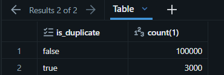

# Health Claims Governance Lab

## Project Overview
This project builds an end-to-end data pipeline on Databricks using synthetic health insurance data (members, providers, and claims). Data is cleaned and deduplicated through a medallion architecture (bronze, silver, and gold layers), with access governed by role.

## Data Model
Catalog: `atlas` — schemas: `bronze`, `silver`, `gold`

| Table | Rows (bronze) | Description |
|---|---|---|
| members | 10,000 | Insured members (demographics, plan, enrollment) |
| providers | 500 | Healthcare providers (specialty, location) |
| claims | 103,000 | Medical claims linked to members and providers (includes ~3% intentional duplicates) |

Data was generated with PySpark and Faker, with deliberate data quality issues to be fixed in the silver layer.

## Evidence

## Access Model
| Role | Bronze | Silver | Gold |
|---|---|---|---|
| Engineers | Read/Write + CREATE TABLE | Read/Write | Read/Write |
| Analysts | No access | Read only | Read only |
| Auditors | No access | Read only | Read only |

Evidence: `SHOW GRANTS` on each schema.

## Known Limitations
- Databricks Free Edition has no account console, so account groups cannot be created.
- Workaround: grants were applied at the user level using placeholder users (`engineers@email.com`, `analysts@email.com`, `auditors@email.com`) instead of groups.
- In a production workspace, these grants would be assigned to groups.

## Repository Structure
| Path | Description |
|---|---|
| `notebooks/ATL-01_Create_Catalog_and_Schemas.ipynb` | Creates the `atlas` catalog and the bronze/silver/gold schemas (ATL-01) |
| `notebooks/ATL-02_Create_Data_Raw.ipynb` | Generates synthetic data with PySpark/Faker and loads it to bronze (ATL-02) |
| `sql/ATL-03_Grant_Permissions.dbquery.ipynb` | User-level grants per layer (ATL-03) |
| `sql/ATL-05_Create_silver_claims.dbquery.ipynb` | Silver claims: flag duplicates instead of deleting (ATL-05) |
| `sql/ATL-06_Column_mask_silver_members.dbquery.ipynb` | Silver members: mask sensitive information (ATL-06) |
| `sql/ATL-07_Row_filter_claims.dbquery.ipynb` | Row filter by region on silver claims (ATL-07) |
| `docs/images/` | Evidence screenshots |

## Duplicate Handling (ATL-05)
`atlas.silver.claims` flags duplicate claims instead of deleting them, so the full history is kept for auditing.

**Rule:** claims with the same `member_id`, `provider_id`, `service_date` and `amount` are considered duplicates.
They are ranked with `ROW_NUMBER()` ordered by `billing_date`:

| Row | is_duplicate | dedupe_reason |
|---|---|---|
| First (earliest billing_date) | false | NULL |
| Others | true | resubmission |

**Result:**

| Table | Rows | Original | Flagged duplicates |
|---|---|---|---|
| bronze.claims | 103,000 | — | — |
| silver.claims | 103,000 | 100,000 | 3,000 |

**Why flag instead of delete:** analysts filter `is_duplicate = false` for reporting, while auditors can still review resubmissions.

**Evidence:** duplicate count by `is_duplicate`.

SQL: `sql/ATL-05_Create_silver_claims.dbquery.ipynb`

## Column Masking (ATL-06)
Sensitive member data in `atlas.silver.members` is protected with Unity Catalog column masks.

| Column | Masked | Masked value | Reason |
|---|---|---|---|
| member_id | No | — | Needed to join with claims |
| national_id | Yes | `*****` + last 3 characters | Personal identifier |
| birth_date | Yes | `NULL` | Personal data |
| gender | No | — | Needed for health reporting |
| region | No | — | Needed for health reporting |

**How it works:** each mask is a SQL function that checks `current_user()`.
Authorized users (engineers) see the real value; everyone else sees the masked value.

**Functions:** `atlas.silver.mask_national_id`, `atlas.silver.mask_birth_date`

**Limitation:** Databricks Free Edition does not support account groups, so the masks
check individual user emails instead of group membership (e.g. `is_account_group_member()`).

**Evidence:** masked query results with an unauthorized user.

SQL: `sql/ATL-06_Column_mask_silver_members.dbquery.ipynb`

## Row Filter (ATL-07)

Analysts only see claims from their own region; engineers see all rows.

**How it works**

- `atlas.silver.analyst_regions` maps each user email to a region (one fictitious analyst per region, because Free Edition has no account groups).
- `atlas.silver.rf_claims_by_region(member_id)` is a Unity Catalog row filter attached to `atlas.silver.claims`. It returns TRUE for engineers, or when the member's region matches the user's region.
- `claims` has no region column, so the region is taken from members via `member_id`.

**Limitation found**

Unity Catalog does not allow a row filter to read a table that has its own row filter or column masks (`UNSUPPORTED_NESTED_ROW_OR_COLUMN_ACCESS_POLICY`). `silver.members` has column masks (ATL-06), so the filter reads a separate lookup table, `atlas.silver.member_regions` (member_id, region), without masks. This table must be rebuilt when members changes.

**Evidence**

| Test | User mapped to | Result |
|---|---|---|
| A | Madrid | Madrid · 20,928 claims |
| B | Catalonia | Catalonia · 21,174 claims |

Same query, different mapping, different rows. SQL: `sql/ATL-07_row_filter_claims.dbquery.ipynb`.
